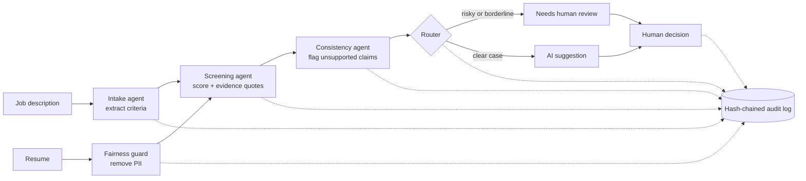
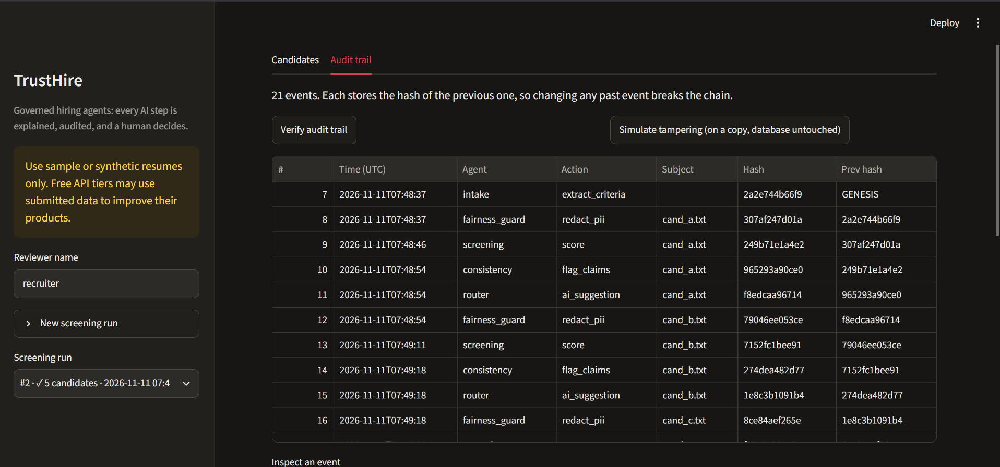
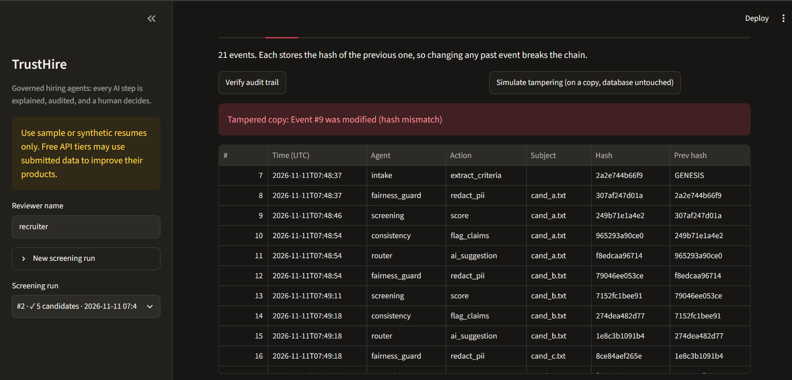

# TrustHire — governed multi-agent hiring copilot

Most AI hiring demos stop at "score the resume". TrustHire focuses on the part
that makes hiring AI usable in real companies: **trust**. Every score comes with
evidence, personal data is removed before the model sees a resume, the AI only
*suggests*, a human decides, and every step is recorded in a tamper-evident log.

> Inspired by the themes on Phenom's product pages (intake, screening, fraud
> detection, and audit trails for AI decisions). This is an independent student
> project, not affiliated with Phenom.

## How it works



| Agent / component | What it does |
|---|---|
| Intake | Turns a job description into must-have / nice-to-have criteria |
| Fairness guard | Removes email, phone, LinkedIn URL, name line and age/gender/marital-status lines before any AI call |
| Screening | Scores 0–100 and must quote the resume as evidence for each matched skill |
| Consistency | Flags skills claimed with no supporting project or experience |
| Router | Marks borderline (50–70) or medium/high-risk candidates as NEEDS_REVIEW |
| Human decision | Approve / reject with a note; the AI never makes the final call |
| Audit trail | Every step is stored with the hash of the previous step (SHA-256) |

## Tamper-evident audit trail
Each event stores `prev_hash` and its own `hash`. Editing or deleting any past
event breaks the chain, and `verify()` reports exactly where. The UI can verify the
chain and simulate tampering on a copy of the data without touching the database.

**Limits (by design):** this detects tampering, it does not prevent it. Someone with
full database access could recompute every hash. In production you would also store
or sign the latest hash somewhere separate.

## Database design (SQLite)
`jobs` → `candidates` → `screenings`, plus `decisions` and `audit_events`.
The AI suggestion (`screenings.ai_status`) and the human decision (`decisions`) are
separate tables so one never overwrites the other. `CHECK` constraints enforce valid
scores, risk levels and statuses; foreign keys are enabled; completed runs cannot be
deleted from the UI.

## Run it
```bash
python -m venv .venv && source .venv/bin/activate     # Windows: .venv\Scripts\activate
pip install -r requirements.txt
cp .env.example .env            # add a free LLM key (Gemini / Groq / local Ollama)
python -m unittest tests.test_core -v    # no API key needed (agents are mocked)
python main.py                  # CLI: sample JD + 5 sample resumes
streamlit run app.py            # the UI
```

## Project layout
```
store.py      SQLite schema and queries
audit.py      hash-chained audit trail
fairness.py   PII redaction
agents.py     intake / screening / consistency agents (any OpenAI-compatible API)
pipeline.py   orchestration, routing, human decisions
app.py        Streamlit UI
main.py       CLI runner
tests/        unit tests (agents mocked)
data/         sample job description and 5 synthetic resumes
```

## Known limitations
- Redaction is rule-based (regex + "first line is the name"); it can miss unusual layouts.
- LLM scores vary between runs and models, which is why a human makes the final decision.
- The consistency agent flags *unsupported* claims; it cannot prove fraud.
- Only `.txt` resumes are supported; use synthetic data only on free API tiers.
- No authentication: reviewer name is self-entered.

## Ideas for next steps
PDF resume parsing, a bias test (same resume with a different name), stronger
anonymization, signed audit checkpoints, role-based access.

## Screenshots
**Candidate review:** ranked results, evidence quotes and consistency flags


**Audit trail:** verification, and detection of a tampered event


